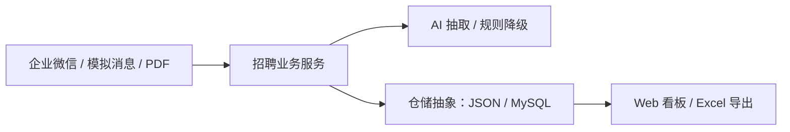

# 企业微信招聘 AI 助手 Demo

**将招聘消息、PDF 简历和面试反馈接入候选人看板。** 使用企业微信回调适配、AI / 规则抽取、业务服务与仓储分层，实现候选人流转、岗位进度和 Excel 导出。

[演示视频](https://github.com/jackwentao/wecom-recruitment-ai-demo/issues/1) · [功能与 API](docs/USAGE.md) · [企业微信联调](docs/wecom-real-callback.md)

## 主要能力

- 本地模拟消息、PDF 上传及企业微信智能机器人加密回调。
- 识别简历录入、面试反馈、岗位需求、进度查询、JD 草稿等任务。
- 模型抽取失败时尝试规则降级，无法确认的任务转人工处理。
- Web 看板展示候选人阶段、岗位进展、风险提示，并导出 Excel。

这是可联调的业务 Demo。完整鉴权、多租户、权限与操作审计属于后续扩展方向。

## 技术与架构

| 层次 | 实现 |
| --- | --- |
| 界面 | React 18、Vite、TypeScript |
| API 与业务 | Express、TypeScript，输入适配与业务服务分层 |
| 抽取 | OpenAI 兼容协议、规则降级 |
| 存储 | 默认本地 JSON，可选 MySQL |
| 文件与测试 | pdf-parse、exceljs、Vitest |



## 快速开始

准备 Node.js 18+ 和 npm。以下 PowerShell 命令在**仓库根目录**执行：

```powershell
npm install
Copy-Item .env.example .env
npm run dev
```

默认 `DATA_STORE=json`，无需配置 MySQL、企业微信或真实模型即可进行本地规则演示。打开 [Web 看板](http://localhost:5173)，后端健康检查为 [GET /api/health](http://localhost:3001/api/health)。

先在页面发送一条模拟消息，观察候选人与岗位变化；也可在 API 运行时执行：

```powershell
npm run simulate -- "@招聘助手 Java后端岗位招 3 人，要求 3 年以上经验，熟悉 Spring Boot，王工负责"
```

## 配置与真实联调

完整变量见 [.env.example](.env.example)。

| 场景 | 配置 |
| --- | --- |
| 本地演示 | `DATA_STORE=json`、`DATA_FILE` |
| 模型抽取 | `OPENAI_BASE_URL`、`OPENAI_API_KEY`、`AI_MODEL` |
| 企业微信回调 | `WECOM_BOT_TOKEN`、`WECOM_BOT_ENCODING_AES_KEY`、`WECOM_BOT_RECEIVE_ID` |
| 企业微信文件下载 | `WECOM_CORP_ID`、`WECOM_APP_SECRET` |
| MySQL | `DATA_STORE=mysql` 及 `MYSQL_*`，再按需运行 `npm run db:migrate` |

企业微信回调、内网穿透和消息联调见[专门指南](docs/wecom-real-callback.md)。演示请使用脱敏的候选人与简历数据。

## 验证

```powershell
npm test
npm run typecheck
npm run build
```

业务冒烟、PDF、回调和可选真实服务验证命令见[使用指南](docs/USAGE.md)。

## 目录与文档

```text
src/client/                Web 页面与样式
src/server/ai/             AI 抽取与规则降级
src/server/wecom/          验签、解密与文件下载
src/server/services/       招聘业务与 Excel 导出
src/server/repositories/   JSON / MySQL 仓储
src/shared/                共享类型
scripts/                   模拟、迁移与业务冒烟
docs/                      功能、API 与联调说明
```

- [功能、业务分层、API 与测试](docs/USAGE.md)。
- [企业微信真实回调联调](docs/wecom-real-callback.md)。
